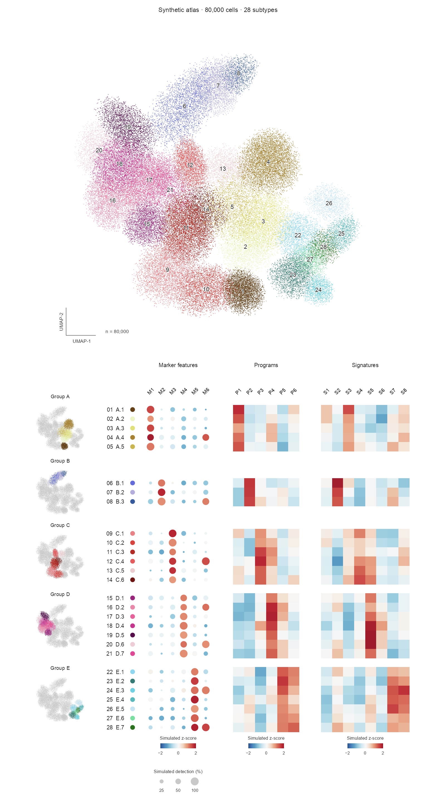

<div align="center">

# scAtlasLoom

**Single-cell evidence, woven into a coherent atlas.**

A Codex skill and R toolkit for publication-oriented single-cell figures.

[](https://github.com/diediray/scatlasloom/releases/latest)


[Quick start](#quick-start) · [Documentation](#documentation) · [Releases](https://github.com/diediray/scatlasloom/releases) · [中文说明](README.zh-CN.md)

</div>

---

scAtlasLoom brings a main UMAP, population highlights, marker evidence, and research-specific panels into one aligned figure. It supports both a single lineage with subtypes and broader parent–subtype hierarchies, while keeping the biological choices specific to each project.

## Preview

<p align="center">
  
</p>

<p align="center"><em>80,000 simulated points · 28 subtypes · 5 parent groups. Coordinates and all values are generated; this is not a biological analysis or a computed UMAP.</em></p>

## What it does

| Component | Purpose |
| --- | --- |
| **Atlas overview** | Show the supplied embedding with consistent population colors and readable labels. |
| **Aligned evidence** | Pair each population highlight with its marker evidence in the same horizontal block. |
| **Flexible hierarchy** | Organize a lineage into subtypes or highlight parent populations across multiple subtype rows. |
| **Optional panels** | Add expression, functional, or condition-related evidence when the research question supports it. |
| **Reproducible exports** | Save PNG, PDF, SVG, alignment tables, and rendering metadata. Dense point clouds are rasterized within vector exports. |

Genes, cluster counts, resolutions, and right-hand panels are not fixed to a particular dataset. The agent workflow selects and documents appropriate evidence; the R tools prepare and render structured inputs.

> [!IMPORTANT]
> **Clustering and annotation require explicit user review.** Submit the current memberships, proposed names, marker evidence, sample support, and unresolved issues before downstream analysis or a final composite figure. Approval of colors or layout does not approve the science. Changes to scientific inputs require review of the affected version.

## Quick start

### 1. Install the skill

Clone into your Codex skills directory. For the default configuration:

```bash
git clone https://github.com/diediray/scatlasloom.git ~/.codex/skills/single-cell-subtype-atlas
```

For a custom Codex configuration directory, use its `skills/single-cell-subtype-atlas` path. Reload skills or start a new session. The invocation name is **`$single-cell-subtype-atlas`**.

### 2. Start with your data and question

```text
Use $single-cell-subtype-atlas on my single-cell dataset at <data directory>.
My research question is <question>.
First prepare clustering and annotation evidence for my review.
After I approve that version, propose the optional panels and create the atlas.
```

The skill instructions and detailed analysis references are primarily in Chinese. R interfaces and this overview are available in English; see the [Chinese guide](README.zh-CN.md).

### 3. Run the synthetic example

From the repository directory, install the rendering dependencies:

```r
install.packages(c("ragg", "svglite", "systemfonts"))
```

Then run:

```bash
Rscript examples/make_hierarchy_demo.R
Rscript scripts/render_atlas.R examples/generated/hierarchy/config.R
```

Outputs are written to `examples/generated/hierarchy/output/`: a 450 dpi PNG, PDF, SVG, a smaller web preview, alignment tables, and rendering metadata. The hierarchy example uses 28 artificial subtypes in five groups and requires no biological data or analysis approval.

For the six-group compact layout, run `examples/make_synthetic_job.R` followed by `scripts/render_modular_atlas.R`; both commands are documented in the [example guide](examples/README.md).

For marker preparation with sparse matrices or Seurat objects, also install `Matrix` and `SeuratObject`. The supplied style uses **Arial**. PDF output uses Quartz on supported macOS builds and Cairo otherwise; check font availability on your platform.

## Workflow

**Inspect data → prepare candidate clusters and annotation evidence → user review → design optional analyses → render and inspect.**

1. Review the dataset, existing processing, embeddings, and research context.
2. Assemble marker evidence and candidate labels, preserving uncertain assignments.
3. Obtain explicit approval of the current clustering and annotation version.
4. Choose optional panels with a clear scientific purpose; ask when the research direction is unclear.
5. Render the figure and check group correspondence, numerical definitions, typography, and final dimensions.

The paired highlight–marker structure remains consistent. Biological identities and downstream questions remain adaptable.

## Documentation

| Entry point | Guide |
| --- | --- |
| Agent workflow | [SKILL.md](SKILL.md) |
| Marker evidence preparation | [Input contract](references/marker_preparation.md) · [Selection rules](references/marker_selection.md) |
| Compact modular atlas | [Rendering contract](references/modular_render_contract.md) |
| Parent–subtype atlas | [Hierarchy and membership contract](references/render_contract.md) |
| Optional panel design | [Scientific design](references/scientific_panel_design.md) · [Analysis choices](references/analysis_choices.md) |
| Figure styling | [Visual grammar](references/visual_grammar.md) |
| Validation and limits | [Validation scope](references/validation.md) |

<details>
<summary>Repository structure</summary>

```text
SKILL.md           Agent instructions and scientific review gate
agents/            Codex interface metadata
scripts/           R preparation, rendering, and scoring helpers
assets/style/      Reusable palettes and style parameters
references/        Scientific choices and input contracts
examples/          Reproducible synthetic rendering example
docs/releases/     Versioned release notes
```

</details>

## Current scope

The compact renderer supports **2–9 groups** and **up to six selected markers per group**. Larger hierarchies use the separate `render_atlas.R` contract or need an implementation adaptation. These are rendering limits, not biological recommendations.

The toolkit is not a one-command clustering or annotation pipeline. Running a renderer does not enforce the human review step; the agent workflow and project approval record must do so. Journal-specific dimensions, scientific validity, and annotation accuracy still need review for each dataset. See [validation scope](references/validation.md).

## Support and contributions

Open a [bug report or feature request](https://github.com/diediray/scatlasloom/issues/new/choose). For rendering problems, include the command, R session information, and a small synthetic example. See [CONTRIBUTING.md](CONTRIBUTING.md) for contribution guidance and [CHANGELOG.md](CHANGELOG.md) for changes.

Maintained by [@diediray](https://github.com/diediray).

## Acknowledgments and citation

The evidence organization draws on the figure design in [Nature Communications, DOI: 10.1038/s41467-025-59341-w](https://www.nature.com/articles/s41467-025-59341-w). Source attribution and the distinction between the paper's analysis and this implementation are documented in [case logic](references/case_logic.md) and the [source manifest](references/source_manifest.json).

Use [CITATION.cff](CITATION.cff) to cite this software, and cite the relevant original methods for your analysis. The public package includes reusable code, documentation, and synthetic example data.
