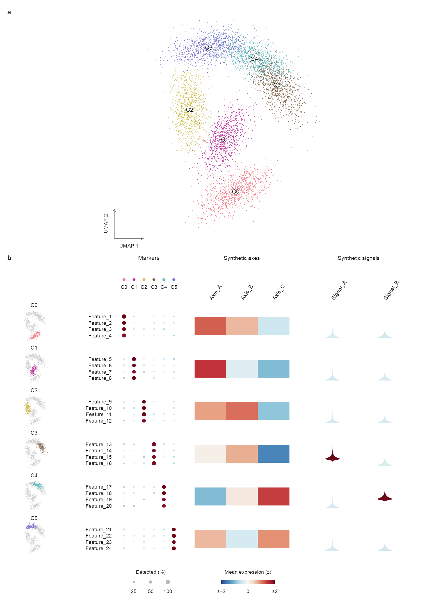

<div align="center">

# scAtlasLoom

**把单细胞证据，组织成清楚而协调的完整图谱。**

面向发表图制作的 Codex skill 与 R 绘图工具。

[快速开始](#快速开始) · [使用文档](#使用文档) · [版本下载](https://github.com/diediray/scatlasloom/releases) · [English](README.md)

</div>

---

scAtlasLoom 将主 UMAP、逐群高亮、marker 证据与按课题设计的扩展模块对齐。既适用于一个谱系下的亚群，也适用于父类—亚群的更大层级；基因、分群参数和右侧内容随研究问题调整。

## 效果预览

<p align="center">
  
</p>

<p align="center"><em>纯合成数据演示：坐标与数值均为生成数据，仅展示绘图接口，不代表真实 UMAP 分析或生物学结论。</em></p>

## 主要能力

| 组件 | 作用 |
| --- | --- |
| **主图概览** | 使用提供的嵌入坐标，保持群颜色一致与标签清楚。 |
| **小 UMAP—marker 配对** | 每群高亮与对应证据处于同一水平块，便于逐行核查。 |
| **灵活层级** | 支持单谱系亚群与父类下多个亚群的组织方式。 |
| **可选探究模块** | 按科学问题选择表达、功能或条件关联证据，避免固定套用某组基因。 |
| **可回查交付** | 输出 PNG、PDF、SVG、行对应表与绘图元数据；矢量文件中的密集点云采用栅格嵌入。 |

> [!IMPORTANT]
> **分群与群命名必须先由用户仔细审核。** 先提交当前细胞归属、候选名称、marker、样本支持及未决问题；获得明确确认后，才继续下游分析与正式组合图。美术认可不等于科学认可。改变科学输入后，重新审核受影响的版本。

## 快速开始

### 1. 安装 skill

使用默认 Codex 配置目录时：

```bash
git clone https://github.com/diediray/scatlasloom.git ~/.codex/skills/single-cell-subtype-atlas
```

如使用自定义 Codex 配置目录，改为该目录下的 `skills/single-cell-subtype-atlas`。重新加载 skill 或开启新会话后调用；skill 的调用名保持为 **`$single-cell-subtype-atlas`**。

### 2. 给出数据与研究问题

```text
使用 $single-cell-subtype-atlas，检查 <数据目录> 中的单细胞数据。
我的研究问题是 <研究问题>。
请先提交分群与群命名的证据供我审核；
等我确认当前版本后，再设计可选模块并制作完整图谱。
```

### 3. 运行纯合成示例

先在 R 中安装绘图依赖：

```r
install.packages(c("ragg", "svglite"))
```

在仓库目录运行：

```bash
Rscript examples/make_synthetic_job.R
Rscript scripts/render_modular_atlas.R examples/generated/figure_job.rds examples/generated synthetic_atlas
```

结果保存到 `examples/generated/`，包括 600 dpi PNG、PDF、SVG、预览图、行对应表和绘图元数据。六个人工群的示例不使用真实生物数据。

需要从稀疏矩阵或 Seurat 对象准备 marker 时，另装 `Matrix` 和 `SeuratObject`。默认样式需要 **Arial** 字体；PDF 在支持的 macOS 环境使用 Quartz，其他平台使用 Cairo，应检查字体与导出结果。

## 工作流程

**核查数据 → 候选分群及命名证据 → 用户审核 → 设计扩展分析 → 成图与检查。**

固定的是“小 UMAP 与本群 marker 相邻、按群对齐”的阅读结构。群数、resolution、marker 名单及数量、功能模块与比较对象都由数据和研究目的决定。右侧方向明确时先汇报设计，方向不清楚时先询问用户。

## 使用文档

| 内容 | 入口 |
| --- | --- |
| 完整 skill 规则 | [SKILL.md](SKILL.md) |
| marker 准备与筛选 | [准备接口](references/marker_preparation.md) · [筛选规则](references/marker_selection.md) |
| 紧凑组合图 | [模块接口](references/modular_render_contract.md) |
| 父类—亚群图谱 | [层级接口](references/render_contract.md) |
| 右侧模块选择 | [科学设计](references/scientific_panel_design.md) · [数值定义](references/analysis_choices.md) |
| 构图与配色 | [视觉规则](references/visual_grammar.md) |
| 验证范围 | [验证说明](references/validation.md) |

## 当前范围

紧凑渲染器支持 **2–9 群、每群至多六个已选 marker**。更复杂的层级使用 `render_atlas.R` 的独立接口或适配实现；这些是绘图接口范围，不是生物学分群标准。

本项目提供 agent 工作流和 R 辅助工具。脚本自身不会代替用户审核，也不会一键完成可靠的分群与注释。每个数据集均需检查科学依据、标签、数值含义与目标期刊版面。

## 反馈与版本

通过 [Issues](https://github.com/diediray/scatlasloom/issues/new/choose) 提交问题或建议。绘图问题请附命令、R 会话信息及最小合成示例。参见 [贡献指南](CONTRIBUTING.md)、[版本记录](CHANGELOG.md) 和 [Releases](https://github.com/diediray/scatlasloom/releases)。

维护者：[@diediray](https://github.com/diediray)。

## 来源与引用

证据组织参考 [Nature Communications, DOI: 10.1038/s41467-025-59341-w](https://www.nature.com/articles/s41467-025-59341-w)。原案例与本实现的关系见 [案例逻辑](references/case_logic.md) 和 [来源清单](references/source_manifest.json)。

软件引用信息见 [CITATION.cff](CITATION.cff)；实际分析还应引用采用的原始方法。公开包包含可复用代码、规则与纯合成示例。
